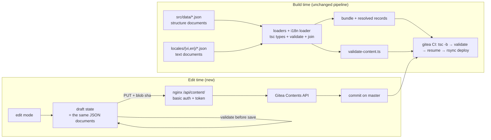
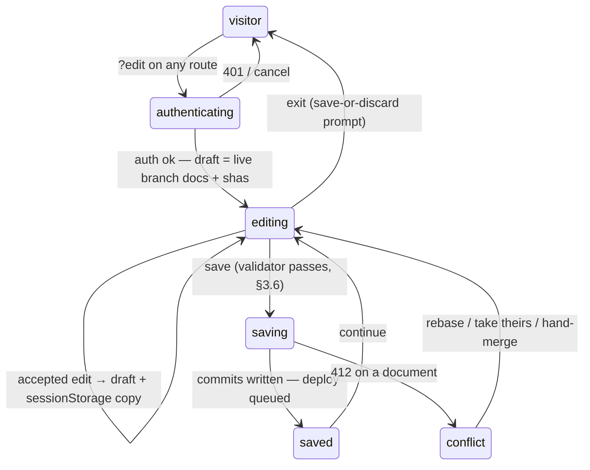

# Specification — v4 Live Edit (i18n Overlay + Git-backed Content Editing)

> **Parent:** `spec.md` (product vision), `specs/v3/spec-v3-i18n.md` (supersedes its Phase 2)
> **Status:** rev.4 — Phases 1–3 implemented 2026-10-22 (see §12 rows 3–15). Remaining (2026-10-23): the owner-side infra setup + first verified run per `spec-v4-deploy-infra.md` rev.7 (Gitea Actions variables `SITE_URL`/`SITE_NAME`, stack `secrets/site_config` with the restricted `GITEA_TOKEN`), and the owner's browser walkthrough. Content documents are pushed and on `master` (§12 row 11); the production nginx step (§6.3) is automated repo-side by `deploy-infra.yml`.

---

## Overview

Two coupled capabilities, one architecture:

1. **Refactor i18n to separate content data, localized text, and UI** — replace the scattered `*En` field pairs and four parallel resolution mechanisms with a locale-overlay architecture: content **structure** and localized **text** both live in JSON documents (structure language-neutral, text per language), TS files keep only typed loaders, exports, and code config.
2. **Live edit with preview, no database** — an authenticated edit mode on the real site: the owner edits text inline on the actual rendered pages (all seven routes), edits structure (add/remove projects, timeline entries, sections) in a JSON panel, sees real theme/motion/responsive behavior, and saves by committing the changed JSON documents to git through the Gitea Contents API. The existing CI pipeline remains the only publishing path.

Git is the content store. CI is the validation gate. There is no database, no new application service, and no runtime content fetch for visitors.

## Why Phase 2 of v3-i18n is superseded

`spec-v3-i18n.md` rows 23–27 planned replacing `strings.ts` with API calls. That direction is abandoned: a personal single-author portfolio does not need a content API. Static dictionaries are type-checked at build, consumed synchronously (no loading states), consumed identically by the resume generator, and served to crawlers exactly like today. Editing ergonomics are solved by the write path in §6, not by moving content off-box.

---

## 1. Current State — measured problems

| # | Problem | Evidence |
|---|---------|----------|
| 1 | Four parallel resolution mechanisms for one problem | `strings.x[lang]` — 107 accesses across 22 files; `field(lang, vi, en?)` — 23 call sites across 9 files (`src/i18n/field.ts`); `resolveField(en, vi, lang)` in `scripts/generate-resume.ts:126-128` — 8 call sites, **reversed parameter order**; a fourth hardcoded bilingual `labels` map inside `scripts/generate-resume.ts:108-123` (EXPERIENCE / SKILLS / PROJECTS / UPDATED / QR_ALT) |
| 2 | Translation machinery lives in the domain model | `src/types/index.ts` carries `*En` sibling fields in 6 interfaces: `Project`, `ProjectSection`, `ExperienceEntry`, `SkillGroup`, `PhilosophyPoint`, `Profile` |
| 3 | Every consumer must know which fields are bilingual | 22 unique consumer files (9 import `i18n/field`, 13 import `i18n/strings`) |
| 4 | Redundant duplicated pairs | Recorded by `spec-v3-i18n.md:66`: "Some `*En` fields are redundant (identical to primary)" — e.g. `awb-detection.title` ≡ `titleEn` |
| 5 | Adding a third language touches every interface and every call site | Each pair is a distinct optional field name (`*En`); no extension point |
| 6 | Content text is welded into structure modules | `src/data/projects.ts` (226 lines) mixes ids, categories, technologies with prose in two languages |
| 7 | Section ids collide across projects | `src/data/projects.ts`: `context`, `problem`, `architecture`, `challenges`, `result` recur across projects — a global `Record<SectionId, …>` text map would force cross-project completeness (see §3.2) |

---

## 2. Architecture Decisions

Each decision lists the chosen option and the rejected alternative with its reason. D6–D7 were added by the 2026-10-22 review.

### D1 — Locale overlay keyed by stable ids (chosen over inline `Localized` pairs)

Text moves out of content records into per-language dictionaries keyed by content id.

Rejected alternative — inline bilingual type (`title: { vi, en? }` inside each record): lighter to migrate, but text stays welded into the content modules, which is exactly the coupling this refactor removes. The overlay is chosen.

### D2 — All content documents are JSON (chosen over TS data modules)

Both halves of content are JSON: **structure** in `src/data/*.json` (language-neutral records: ids, categories, technologies, metrics, urls, `featured`, `variant`, section `{id, type}`) and **text** in `src/i18n/locales/{vi,en}/*.json`. TS keeps only typed loaders that preserve the current export names and types, so no consumer import path changes.

This decision is what makes §5 structural editing possible at all: a draft that can only override text can never add a project, because the project record lives in code. With structure in JSON, the JSON panel edits the same documents the Contents API commits, and the round-trip is lossless. JSON has no comments — authoring comments move to the loaders and types, which stay TS. Type safety: every JSON import is annotated in its loader, so `pnpm build` (`tsc -b`) fails on any shape violation. Requires `resolveJsonModule: true` in `tsconfig.app.json` (not currently set).

Rejected alternative — structure stays in TS, v4 is text-only editing: safe, but it removes the capability this spec exists for ("admin updates content"). Chosen against.

Code config stays TS, not content: `resume.ts` (availability, `resumeQr`), `navigation.ts`, `palettes.ts`, `social.ts`, `site.ts`.

### D3 — Content and UI strings are consumed through a context provider

All content flows through `I18nProvider` / `useI18n()`, with the static build-time documents as the default context value. This is the prerequisite for live preview: an editor overrides the context value with draft state and the **real components** render draft data — real theme, real motion, real responsive behavior. Preview is the production app, never a mockup.

### D4 — Git is the content store; Gitea Contents API is the write path; CI is the validator

No database. The content store is the git repo `https://code.vugado.com/dong.nguyen/cv` (self-hosted Gitea). Editing a file there already deploys via the existing `deploy.yml` (push to `master` → build → resume → rsync). The admin write path is a thin authenticated proxy to the Gitea Contents API (§6). A malformed content commit fails the build gate (§3.6), so the last good deploy stays live — the pipeline is the validation gate.

### D5 — Layout boundary: content is editable, design is code

Editable through data documents: all text, structure records (add/remove/edit projects, experience entries, skill groups, sections), `featured`, `variant: 'current' | 'gap'`, ordering by existing fields. Not editable without new machinery: card design, typography, spacing, section composition, motion recipes — these are the hand-tuned design of the site. A WYSIWYG layout designer would require a layout DSL + generic renderer (page-builder machinery) and is **explicitly deferred** (§10, §12 row 15).

### D6 — Display name stays localized (default; owner may override)

`Profile.nameEn` is a **required** field today (`src/types/index.ts:70`): the resume and hero resolve a display name per language (Vietnamese vs Western order). Preserving behavior: `name` becomes a required entry of the profile text dict in **both** languages (`profile.name` in `content.vi.json`, `profile.name` in `content.en.json`). `firstName` / `lastName` stay language-neutral in `profile.json`. If the owner later prefers one canonical name, that is a data edit, not a code edit. (This was Open Question 3 in rev.1; it is a decision because Phase 1 cannot type the interfaces before it is settled.)

### D7 — Cross-file consistency is enforced by tsc + a shared validator

Two mechanisms, each for what it is good at:

- **tsc** joins each JSON document to its declared type independently: structure loaders annotate against interfaces whose `id` fields are closed unions; text dictionaries are annotated `Record<ProjectId, …>` etc. Adding an id to a union without text in `content.vi.json` is a build error; a text key outside the union is a build error.
- **`scripts/validate-content.ts`** (shared with edit mode via `src/i18n/validate.ts`) enforces what types cannot express across two JSON files: every section id present in `projects.json` has text in `content.vi.json` (sections are per-project arrays with colliding ids — no global union), no orphan text keys, `en` keys correspond to existing structure ids. It runs in the CI build job and in the browser before save (§5.1).

### D8 — Edit-mode entry is `?edit` on any route (owner decision, 2026-10-22)

Chosen over a dedicated `/edit` route (which would need its own page selector and a second mental model, against D3's preview-equals-app logic) and over a separate host (DNS/cert/nginx duplication). `index.html:13` already publishes clean-URL canonicals, so `?edit` is inert for crawlers; the mode is inert without authenticated write credentials; the query is stripped on exit (§5.2). The owner bookmarks the entry.

### D9 — `profile.tagline` is segmented; markup moves to `Hero.tsx` (owner decision, 2026-10-22)

The only HTML string in the entire data layer is `profile.tagline` (`src/data/profile.ts:11`, `<span class='ok-possible name-highlight'>yes</span>`). The value becomes `Array<{ text: string; emphasis?: boolean }>`; `Hero.tsx` renders the span with its existing classes from data instead of `dangerouslySetInnerHTML`. After migration no content document contains HTML — the validator can enforce plain text (§3.6 rule 5), and the tagline becomes inline-editable segment by segment (§5.1). The current value maps to three segments (`…Full Stack Developer, ` / `{text: 'yes', emphasis: true}` / `, có thể.`); `taglineEn` becomes a single plain segment. The resume generator does not consume the tagline — no resume impact.


### D10 — Target-branch editing via `?edit=<branch>` (owner decision, 2026-10-22)

The Gitea Contents API already supports branch targeting natively — `?ref=<branch>` on GET, `branch` in the PUT body — so the editor exposes it in the entry URL instead of hardcoding `master`: `?edit=<branch>` reads and writes that branch; a bare `?edit` (or `?edit=1`) resumes the session's last branch, defaulting to `master`. Branch names are validated against git's ref rules (`edit-mode.ts`) before any request; an illegal name exits edit mode exactly like a failed auth. The target branch must already exist in the repository — Contents API updates never create branches. Deploy semantics are unchanged (owner decision): only pushes to `master` trigger the pipeline, so a save to a working branch shows a merge hint in the EditBar instead of the deploy-queued note. Chosen over a fixed env-configured branch (no per-session flexibility) and over a branch-selector UI (branch-list API call + a new control surface for a single user).

---

## 3. Target Architecture

```
src/data/
  profile.json   profile.ts        ← structure documents + typed loaders (exports unchanged:
  skills.json    skills.ts            `profile`, `skillGroups`, `experiences`, `projects`)
  experience.json experience.ts
  projects.json  projects.ts
  resume.ts  navigation.ts  palettes.ts  social.ts  site.ts   ← code config, unchanged
src/i18n/
  locales/
    vi/ui.json        vi/content.json      ← complete, keyed by id / key path
    en/ui.json        en/content.json      ← ui complete (checked against UIDict); content per-field partial
  validate.ts                              ← cross-document consistency rules (§3.6)
  dict-types.ts                            ← structure types, UIDict, Content*Text, Resolved* types
  index.ts                                 ← load + validate + merge → UI[lang], CONTENT[lang]
  provider.tsx                           ← I18nProvider + useI18n(), default = static documents
scripts/
  validate-content.ts                    ← CLI wrapper over src/i18n/validate.ts (CI + save gate)
```

### 3.1 Stable id unions (`src/types/index.ts`)

Text dictionaries are only type-safe against closed id unions:

```ts
export type ProjectId = 'iot-dws-integration' | 'awb-detection' | 'facility-management' | 'local-llm-experiments';
export type ExperienceId = /* existing ExperienceEntry.id values */;
export type SkillGroupId = /* NEW — slug of group title, e.g. 'backend-systems' */;
export type PhilosophyId = /* NEW — slug of point title */;
```

- `Project.id` already appears in URLs — ids are already stable and published.
- `SkillGroupId` / `PhilosophyId` do not exist today and must be added to the structure documents; they are internal-only keys and never appear in URLs.
- **No `SectionId` union.** Section ids collide across projects (`context`, `problem`, `result`, … appear in several projects); a global union would force every project's text to cover every other project's sections. Section coverage is enforced per project by the validator (§3.6) instead.
- Adding a new project/experience/skill/philosophy item = 3 edits: one line in the union, one record in the structure document, one entry in `content.vi.json`. tsc + validator catch any missing leg.
- **Deleting a record is the mirror image** (owner-reported 2026-10-24): the structure row and its text go, and the union member must go with them. A stale member makes `Record<SkillGroupId, SkillGroupText>` reject the shortened text document — `TS2741: Property '"logistics-technology"' is missing …` at `src/i18n/index.ts:69`: `pnpm build` and the CI gate fail after a delete the editor itself performed correctly. `saveIdUnions` therefore **balances** the unions instead of only appending: `diffIdsWithUnions` reports missing *and* stale members against `committedStructures()` (the post-PUT base, so a document that has not landed never reads as stale), `applyUnionChanges` rewrites exactly that union's member list — survivors keep their order, an emptied union renders `never` — in one PUT under the same commit policy. Unions are parsed as their declaration span, never searched as substrings: a slug can legitimately appear elsewhere in the same file (`ProjectCategory` carries project-like slugs, `PageId` carries `home`), and a substring test silently skips the leg. Line endings are preserved, so the reviewed commit stays one line.

### 3.2 Document types (`dict-types.ts`)

Structure (language-neutral) and text (per language) are separate documents joined by the loader into resolved records that components consume:

```ts
// --- structure (src/data/*.json) ---
// Shapes as implemented, incl. the row 18–19 follow-up (2026-10-22): display
// strings that are language-dependent (company labels, durations, roles,
// metrics, interests, roles, keywords) moved from structure to text.
export type ProjectStructure = {
  id: ProjectId; category: ProjectCategory; technologies: string[];
  featured: boolean;
  sections: Array<{ id: string; type: 'text' | 'diagram' | 'metrics' | 'code' }>;
};
export type ExperienceStructure = {
  id: ExperienceId; location?: string;
  variant?: 'current' | 'gap'; logo?: string;
};
export type SkillGroupStructure = { id: SkillGroupId; skills: string[] };
export type ProfileStructure = {
  firstName: string; lastName: string; email: string;
  githubUrl: string; linkedinUrl: string; githubHandle: string; linkedinHandle: string;
  telegramUrl: string; telegramHandle: string;
  philosophy: Array<{ id: PhilosophyId }>;
};

// --- text (src/i18n/locales/{vi,en}/content.json) ---
export type SectionText = { title: string; content: string };
export type ProjectText = {
  title: string; summary: string; role: string; metrics?: string[];
  sections: Record<string, SectionText>;   // keys validated against the structure's section ids
};
export type ExperienceText = { title: string; company: string; duration: string; responsibilities: string[] };
export type SkillGroupText = { title: string };
export type ProfileText = {
  name: string; title: string; bio: string;
  subtitle: string; tldr: string;                                   // row 18 — moved out of ui.json
  tagline: Array<{ text: string; emphasis?: boolean }>;             // D9 — markup lives in Hero.tsx, never in content
  currentInterests: string[]; roles: string[];                      // row 19 — term lists, EN-only until translated per language
  philosophyQuotes: Array<{ title: string; details: string[] }>;    // row 18 — the owner's essays
  philosophy: Record<PhilosophyId, { title: string; description: string; keywords: string[] }>;
};

export type ContentVi = {
  profile: ProfileText;
  skills: Record<SkillGroupId, SkillGroupText>;
  experience: Record<ExperienceId, ExperienceText>;
  projects: Record<ProjectId, ProjectText>;
};

// Defined locally in dict-types.ts — PartialDeep is NOT a TypeScript builtin.
// Objects: every key optional + recursed. Arrays: atomic (whole-array fallback, never per-item).
type PartialDeep<T> = T extends readonly unknown[] ? T
  : T extends object ? { [K in keyof T]?: PartialDeep<T[K]> } : T;

export type ContentEn = { [K in keyof ContentVi]: PartialDeep<ContentVi[K]> };
```

Fallback semantics (unchanged from `field()` today):

- `ContentVi` is a **complete mapped type** — omitting text for any union id is a `tsc` error. The primary language is enforced at build.
- `ContentEn` is partial **per field**, including inside `sections` and `philosophy`. Missing English field → Vietnamese value. Arrays fall back whole-array; mixed-language arrays are not a v4 feature. `deepMerge` therefore treats arrays as atomic values.
- Redundant identical pairs (Problem 4) are deleted: identical text simply omits the `en` key.

### 3.3 UI dictionary (`ui.json`)

`strings.ts`' key tree is preserved verbatim; the resume script's `labels` map (§1 row 4) is merged in as a `resume` section. `UIDict` is derived from the vi import and the en import is checked **against** it — both files are then complete by construction, and the derivation is not circular (rev.1 wrote `UIDict = typeof uiVi` while `uiVi: Record<Language, UIDict>`):

```ts
import uiViJson from './locales/vi/ui.json';
export type UIDict = typeof uiViJson;                 // literal structure of the complete tree
const uiVi: UIDict = uiViJson;
const uiEn: UIDict = uiEnJson;                        // tsc enforces en completeness
```

### 3.4 Loader (`index.ts`) — validate and join once at module load

```ts
import profileStructure from '@/data/profile.json';
import projectsStructure from '@/data/projects.json';   // … skills, experience likewise
import contentViJson from './locales/vi/content.json';
import contentEnJson from './locales/en/content.json';

const profile: ProfileStructure = profileStructure;   // tsc validates shape + id unions
// … (skills, experience likewise)
const contentVi: ContentVi = contentViJson;
const contentEn: ContentEn = contentEnJson;
validateContent({ profile, skills, experience, projects }, contentVi, contentEn); // §3.6

const mergedEn: ContentVi = deepMerge(contentVi, contentEn);  // arrays atomic, one-time

export const UI: Record<Language, UIDict> = { vi: uiVi, en: uiEn };

// Resolved records: structure joined with text — components never join by id themselves.
export type ResolvedProject = ProjectStructure & { title: string; summary: string;
  sections: Array<{ id: string; type: 'text' | 'diagram' | 'metrics' | 'code'; title: string; content: string }> };
export type ResolvedExperienceEntry = ExperienceStructure & { title: string; responsibilities: string[] };
export type ResolvedSkillGroup = SkillGroupStructure & { title: string };
export type ResolvedProfile = ProfileStructure & ProfileText;
export type ResolvedContent = {
  profile: ResolvedProfile; skillGroups: ResolvedSkillGroup[];
  experiences: ResolvedExperienceEntry[]; projects: ResolvedProject[];
};
export const CONTENT: Record<Language, ResolvedContent> = {
  vi: join(structures, contentVi), en: join(structures, mergedEn),
};
```

`src/data/*.ts` loaders keep exporting the raw structure under today's names (`profile`, `projects`, `experiences`, `skillGroups`) for `scripts/generate-sitemap.ts`, which consumes structure only. Both languages are already in today's bundle (`strings.ts` + `*En` fields); splitting them into JSON documents does not change bundle size materially.

### 3.5 Provider and consumer usage

```tsx
// provider.tsx — must mount inside LanguageProvider (lang is read to pick the resolved pair)
export function I18nProvider({ children, override }: { children: React.ReactNode; override?: ResolvedI18n }) { … }
export function useI18n(): ResolvedI18n { … } // default = build-time documents for the current lang
export type ResolvedI18n = { ui: UIDict; content: ResolvedContent };
```

Every consumer collapses to one pattern — components iterate **resolved records**, never join structure and text themselves:

```tsx
const { ui: s, content: c } = useI18n();
{c.projects.map(p => <ProjectCard key={p.id} project={p} />)}   // p.title / p.summary already joined
<span>{s.nav.home}</span>
```

`src/i18n/field.ts` and `src/i18n/strings.ts` are deleted. `resolveField` and the `labels` map in `scripts/generate-resume.ts` are deleted; the script imports `UI`/`CONTENT` (resolved records — simpler than today's per-field resolution) — its `--lang=` flow is unchanged.

### 3.6 Cross-document validation (`src/i18n/validate.ts`)

Rules, run at load (dev), in CI (`pnpm tsx scripts/validate-content.ts`, added to the build job), and in the browser before save:

1. Every section id in each project's structure array has a text entry in `content.vi.json`.
2. No orphan text keys: every key in `content.vi/en.json` (including nested `sections`, `philosophy`) corresponds to an id present in structure.
3. `en` text keys likewise correspond to existing structure ids (partial coverage allowed).
4. `ui.en.json` completeness is enforced by tsc (§3.3), not here.
5. Text values contain no HTML markup (`<` / `>`) — after D9 no content document holds HTML; literal angle brackets in prose are rejected as a data error.

Failure output lists exact document paths so a content edit can be fixed in the JSON panel.

### 3.7 Data flow



---

## 4. Document Migration

Field-by-field disposition. "structure" = `src/data/<module>.json`; "text" = `content.{vi,en}.json` under the record's id.

| Module | → structure document | → text document | New fields |
|---|---|---|---|
| `profile.ts` | `firstName`, `lastName`, `email`, all URLs/handles, `currentInterests`, `roles`, `keywords`, `philosophy[].{id, keywords}` | `title(+En)`, `bio(+En)` → `profile.*`; `tagline(+En)` → `profile.tagline` as segments (D9); `name`/`nameEn` → `profile.name` in **both** language docs (D6); `philosophy[].title(+En)`, `description(+En)` | `PhilosophyId` per point |
| `skills.ts` | `id`, `skills[]` (technical terms, EN-only per v3-i18n) | `title(+titleEn)` → `skills[id].title` | `id: SkillGroupId` |
| `experience.ts` | `id`, `company`, `duration`, `location`, `variant`, `logo` | `title(+En)` → `experience[id].title`; `responsibilities(+En)` → `experience[id].responsibilities` | — |
| `projects.ts` | `id`, `category`, `role`, `technologies`, `metrics`, `featured`, `sections[].{id, type}` | `title(+En)`, `summary(+En)` → `projects[id]`; `sections[].title(+En)`, `content(+En)` → `projects[id].sections[sectionId]` | — |
| `i18n/strings.ts` | — (file deleted) | all 130 lines → `ui.{vi,en}.json`, same key tree | — |
| `scripts/generate-resume.ts` `labels` map | — | EXPERIENCE / SKILLS / PROJECTS / UPDATED / QR_ALT → `ui.{vi,en}.json` `resume` section | — |
| `resume.ts`, `navigation.ts`, `palettes.ts`, `social.ts`, `site.ts` | unchanged — code config, not content | resume language labels already in `strings.nav` → move with ui | — |

Follow-up — rows 18–19 (2026-10-22 dictionary-boundary audit, implemented). The table above stays as the original migration record; this is the cutover it deferred:

| Moved | From | To |
|---|---|---|
| `about.subtitle`, `experience.tldrText`, `philosophy.quotes` | `ui.{vi,en}.json` | `profile.subtitle`, `profile.tldr`, `profile.philosophyQuotes` in `content.{vi,en}.json` — person text is content: validated, editable in edit mode |
| `experience.company`, `experience.duration` | `experience.json` | `experience[id].company` / `.duration` in the text documents. VI carries localized values ("11/2026 – nay", "Sẵn sàng cho cơ hội mới", "Nghỉ giữa chặng"); en overrides with the original strings; proper company names are identical per language (en omits); numeric date ranges are locale-neutral and inherited |
| `projects.role`, `projects.metrics` | `projects.json` | `projects[id].role` / `.metrics` in the text documents — role keeps EN (the owner's title convention, same as `profile.title`), metrics localized ("Đã triển khai tại 16 sortations") |
| `profile.currentInterests`, `profile.roles`, `philosophy[].keywords` | `profile.json` | `profile.currentInterests` / `profile.roles` / `profile.philosophy[id].keywords` in the text documents — term lists follow the technologies/skills EN-only convention, now localizable per-field by JSON edit |

Structure documents now carry only language-neutral fields (§3.2). The join keeps resolved records identical for consumers: components iterate resolved records and never noticed the move. `ui.json` keeps only chrome; `edit.fields` gained labels for the new inline-editable paths.


Type changes in `src/types/index.ts`: every `*En` optional is deleted from the 6 interfaces; id unions added (§3.1); structure/text/resolved types as §3.2. The old `Project` / `ProjectDetail` / `ExperienceEntry` interfaces are replaced by `*Structure` + `Resolved*` types — no shim left behind.

---

## 5. Edit Mode — live edit on all pages

### 5.1 Shape: edit mode on the real site (chosen over a separate `/admin` shell)

The site itself gains an edit mode. There is no second preview machinery — the seven routes *are* the preview.

- **Entry:** edit mode activates only for the authenticated owner (handshake against the protected proxy endpoint, §6.2; activation stored in `sessionStorage`; a `?edit` query on any route re-enters the mode within a session; the query is stripped from the URL on exit so shared/canonical URLs stay clean). Anonymous visitors never see edit affordances.
- **Draft initialization:** the draft is initialized from **live repository files fetched through the proxy** (`GET` per document + its blob `sha`), not from the bundle — the bundle may be older than master if anyone edited via Gitea web since the last build, and a bundle-seeded draft would silently revert those edits. The static bundle is used only as an offline fallback, with a visible "stale" warning.
- **Mechanism:** edit mode wraps `<Layout>` in `<I18nProvider override={draft}>`. All pages, all components, both languages render the draft — text **and** structure.
- **Inline text editing:** rendered text nodes bound to a text-document path become editable on focus (`contentEditable`); blur writes `{ path, value }` into the draft. Editing `projects['iot-dws-integration'].title` updates the card on `/projects`, the header on `/projects/:id`, and the featured block on the home page **simultaneously** — one draft, every consumer.
- **Editable surface (curated scope):** inline editing covers **text documents only** — profile bio and tagline (each tagline segment is an individually editable span), profile subtitle / career TL;DR / philosophy quote titles+paragraphs (row 18), project titles/summaries/section content/role, experience titles/companies/durations/responsibilities (row 19), skill group titles, philosophy titles/descriptions. `ui.json` is **read-only** in v4 (labels/aria are low-frequency chrome). This bounds the wrapping work to the ~40 content render sites, not the 130+ UI-string sites. Adjacent tagline segments are separate edit targets — the caret does not cross a segment boundary; intended behavior (D9), not a bug. *Superseded 2026-10-23 by `spec-v4-inline-editing.md`: editing is triggered by a per-field pencil icon, never by text focus; tag arrays (`currentInterests`, `roles`, `keywords`, `metrics`, `technologies`, tagline segments + emphasis toggle) become chip-level edit units with add/delete/move.*
- **Structural editing:** *Original scope: add/remove/edit records in a JSON panel docked beside the page, validated against §3.2/§3.6 before accepting.* Superseded 2026-10-23 by `spec-v4-inline-editing.md` (E1): the panel is deleted; record add/delete/move and rare fields (`featured`, `variant`, `logo`) move to on-page affordances (ghost add controls, confirm-gated delete, per-record settings popover). Validation-before-accept semantics are unchanged.
- **Language/theme:** the existing language, theme, and palette controls work unchanged inside edit mode — the owner previews exactly what visitors will see.
- **Save:** a persistent save bar lists the diff (changed paths per document), runs the §3.6 validator on the full draft, then PUTs each touched document through the proxy (§6). Unsaved draft is invisible to visitors.

Rejected alternative — `/admin` route with preview pane + bespoke forms: same engine, more code (a form per content type), and a second shell to maintain. Revisit only if inline editing proves ergonomically insufficient.

### 5.2 Session lifecycle



- **Entry:** `?edit` on any route → the app probes the protected endpoint once (hidden-iframe GET to trigger the native Basic prompt, §6.2). 401 or cancel → normal visitor site, zero affordances. Auth OK → session flag in `sessionStorage` + draft initialization (§5.1). Within a session the browser re-attaches Basic credentials to later requests on its own — no repeated prompt. The probe targets the session's branch: `?edit=<branch>` selects it, a bare `?edit` resumes the last one or `master` (D10); the branch name is validated before the probe and stored beside the session flag.
- **Durability:** every accepted edit is also copied to `sessionStorage` (the documents are tens of KB). An accidental reload restores the draft: the app re-fetches live files, re-applies the saved draft, and flags any document whose blob `sha` moved → conflict flow (§5.6). SPA navigation never loses the draft; `beforeunload` warns while dirty.
- **Exit:** explicit action in the EditBar — save-or-discard prompt if dirty, clear flag + draft, `history.replaceState` strips `?edit`.

### 5.3 `EditableText` contract (inline editing)

- **Visitor mode is transparent:** the component renders exactly the element the site renders today (same tag, same attributes, text as children). Zero DOM/CSS/motion difference outside edit mode.
- **Affordances (edit mode only):** hover → 1px dashed `--muted` underline + `cursor: text`; focus → 2px-offset `--accent` ring (the bar's existing focus language); `aria-label` = human-readable path ("Project iot-dws — Summary"); `role="textbox"`, `aria-multiline` for multi-line fields.
- **Commit on blur only — never per keystroke.** This is a hard rule: Vietnamese IME composition (dấu) must never be truncated mid-composition; the draft updates only after composition completes.
- **Keys:** Esc cancels the current edit and restores the last committed value. Enter commits + blurs single-line fields (titles, names); in multi-line fields (bio, summary, section content, responsibilities items) Enter inserts `\n` — text is stored as plain text with newlines, rendering unchanged.
- **Paste** is sanitized to plain text (`textContent`, no HTML).
- **Empty required values** are rejected at commit: inline error on the field + entry in the EditBar list; the field keeps focus.
- **Per-field revert** action appears after a commit; document-level discard lives in the EditBar.
- **Motion safety:** `EditableText` edits only the text node inside already-animated elements; motion keeps transform ownership — the existing animation recipes are untouched.

### 5.4 JSON panel (structural editing)

> **Superseded 2026-10-23** by `spec-v4-inline-editing.md` (E1): `JsonPanel.tsx` is deleted; everything this section described is edited on the page instead. Kept as the implementation record of what was built in 3b — the templates, orphan-free delete, and validation gating it used are reused by the inline controls.

- Docked sheet: 420px right side above 1024px, full-width bottom sheet below; toggled from the EditBar; the live page stays interactive beside it.
- Tabs: `profile.json`, `skills.json`, `experience.json`, `projects.json`, `content.vi.json`, `content.en.json`; `ui.{vi,en}.json` shown read-only for reference.
- Editor: monospace textarea + parse/validation status bar; errors render JSON-pointer paths with line numbers. The preview keeps rendering the **last valid draft** — an invalid panel state never reaches the page or the save.
- **Templates:** "add project / experience / skill group / philosophy point / section" inserts a well-shaped skeleton into the structure document and text stubs into `content.vi`/`content.en` in one action — the new card appears in the preview immediately; empty required fields show as validation warnings until filled.
- **Delete** removes the record's text entries from both text documents in the same action — orphan text is never created.
- Each tab header shows the required shape as a comment block copied from `dict-types.ts` (JSON has no comments; the panel chrome supplies them).

### 5.5 Draft, diff, undo

- Copy-on-write: untouched documents stay the fetched baselines; only touched documents are copied into the draft.
- Change tracking: per-document set of changed JSON paths; the EditBar shows the dirty-document count and an expandable per-path old→new preview.
- Undo model: per-field revert (inline action) + per-document discard (EditBar). No full edit history in v4 — after a save, git is the history; before a save, revert covers the realistic undo need.

### 5.6 Save, deploy feedback, conflicts

- Save pipeline: validate the full draft (§3.6) → serialize touched documents (2-space indent, key order preserved, §6.1) → sequential PUTs, each with the message `content: <first change summary> (<n> paths)`.
- Progress UI: per-document status line (queued → written / failed), then a summary with commit SHAs and a link to the pipeline run. The bar states "deploy queued — live after CI": the site changes only when the pipeline finishes (§6.1 policy).
- **Conflict (412 on one document):** fetch the current file, then a per-document three-way choice — **rebase** (re-apply my changed paths onto the new base), **take theirs** (discard my changes for that document), or **hand-merge** (the panel opens with both versions side by side). Untouched documents are unaffected.
- **Partial failure** (network/5xx mid-sequence): the bar reports exactly which documents landed and which did not; retry resumes from the first unwritten document — landed documents are never rewritten (their content already matches, their shas are refreshed).

### 5.7 What live edit covers / does not cover

| Live in the preview | Only after commit + CI |
|---|---|
| All text on all 7 routes, both languages | Resume PDFs (`generate-resume.ts` runs at build) |
| Structural changes: new/removed cards, detail routes, timeline entries | `sitemap.xml` + canonical links (generated at build). OG tags in `index.html` are static strings — **not updated by v4** |
| Theme, palette, language rendering | Layout design (see D5) |

### 5.8 Layout knobs and the deferred layout designer

v4 exposes no new layout knobs. `featured` and `variant` already exist and are editable via the JSON panel (superseded 2026-10-23: the same fields are edited in the per-record settings popover, `spec-v4-inline-editing.md` §2.4). A `layout.ts` config (section order/visibility) and any WYSIWYG layout editing are recorded here as **deferred research**, explicitly out of v4 scope.

---

## 6. Write Path, Authentication, Authorization

### 6.1 API

Repo: `https://code.vugado.com/dong.nguyen/cv` — self-hosted Gitea (API verified live: `/api/v1/version` → 28.1.0). Contents API paths are fixed to this repo:

- `GET /api/v1/repos/dong.nguyen/cv/contents/{path}` — read the live file + its blob `sha` when a draft session starts (§5.1).
- `PUT /api/v1/repos/dong.nguyen/cv/contents/{path}` — body: base64 content, `message`, `branch`, `sha` (the file's blob ID). Gitea 28 `UpdateFile` keys create-vs-update on this field: empty `sha` → create (an existing file answers 422 "repository file already exists"); a stale `sha` → 422 with a "does not match" message → editor refetches and re-applies; lost updates are impossible. *(Amended 2026-10-23 after the first real save against 28.1.0 — the text previously described the retired `last_commit_sha`/412 contract; `last_commit_sha` exists only in responses.)*

**Save/CI policy (decided):** a save writes its touched documents as **sequential PUTs to `master`** — each is one commit and triggers the existing pipeline. Consequences accepted: a save touching 2–4 documents produces 2–4 sequential CI runs, and between runs the deployed site can transiently mix old/new documents. For a single owner publishing at low frequency this is the boring, correct choice; the final state after the last pipeline is always consistent. (Branch-then-merge for a single pipeline run is noted as a future optimization, not v4.)

Serialization on save: 2-space indent, key order preserved from the parsed document — diffs in Gitea stay reviewable.

The proxy exposes the Contents API for this repo only. It does not restrict which file paths a PUT may name; with a single owner this is accepted. Optional hardening (noted, not v4): an nginx `map` whitelisting the 8 content document paths.

### 6.2 Proxy + authentication (no new service)

Add to `nginx.conf` using the stock nginx image's envsubst template support (`/etc/nginx/templates/nginx.conf.template`), so the token comes from the environment, never the bundle:

```nginx
location /api/content/ {
    auth_basic           "Editor";
    auth_basic_user_file /etc/nginx/htpasswd;
    proxy_pass https://code.vugado.com/api/v1/repos/dong.nguyen/cv/contents/;
    proxy_ssl_server_name on;
    proxy_set_header Host code.vugado.com;
    proxy_set_header Authorization "token ${GITEA_TOKEN}";
}
```

- **Authentication:** HTTP Basic (htpasswd, one user today) at the proxy; the Gitea write token lives only in the container environment. A write-capable token MUST NEVER appear in the SPA bundle — the bundle is public.
- **Handshake mechanics:** `fetch()` does not trigger the browser's Basic-auth prompt. The edit-mode entry loads the protected `GET` once through a hidden iframe to trigger the native prompt; the browser then attaches the cached credentials to subsequent `fetch` calls for the origin. Fallback: a credentials form whose value is kept in `sessionStorage` for the session (plaintext — accepted for a personal site; state it in the UI).
- **Security model:** edit mode is a UI affordance, not the protection. The protected endpoint is the security boundary: an unauthenticated browser cannot write, regardless of how edit mode was reached.

### 6.3 Production deployment of the proxy (operational step — was missing in rev.1)

`deploy.yml` rsyncs `dist/` only — `nginx.conf` is **not** deployed by the pipeline. Phase 2 therefore includes an explicit one-time server step: update the stack's nginx config + `htpasswd`, set `GITEA_TOKEN` in the stack environment, and reload the nginx container on `/opt/stacks/dong-site`. Recorded as Phase 2 step 0 in §7 and §12. **Superseded 2026-10-23 by `spec-v4-deploy-infra.md`:** `deploy-infra.yml` ships `nginx.conf` / `compose.yaml` / `deploy/htpasswd` and redeploys the container automatically; `GITEA_TOKEN` now lives in the stack's `secrets/site_config` (D13), not the stack environment.

### 6.4 Authorization tiers (future-ready, no custom RBAC)

| Role | Capability | Mechanism |
|---|---|---|
| Owner (today) | commit to `master` → immediate CI deploy | proxy token |
| Editor (if ever needed) | commit to `content` branch only | Contents API `branch` param + a second token; owner merges in Gitea; only `master` deploys |
| Visitor | read-only | no endpoint access |

Audit and rollback are git-native: history is the audit log; `git revert` + CI is the rollback.

---

## 7. Implementation Details

### Phase 1 — foundation (no visible feature; prerequisite for everything else)

Commit policy: Phase 1 lands as **one atomic commit** — it is a 30-file mechanical migration whose intermediate states are worse than either end. (Tension with the repo rule "keep changes small" is acknowledged deliberately: splitting it would leave half the codebase on each of two incompatible contracts.)

1. `src/types/index.ts`: id unions (§3.1), structure/text/resolved types (§3.2), `PartialDeep`; delete all `*En` fields from the 6 interfaces.
2. Create `src/data/{profile,skills,experience,projects}.json` **via a throwaway extraction codemod** (`scripts/extract-content.ts`, deleted after the run): it reads today's modules and writes the structure documents programmatically — values are never hand-moved, because types verify structure but cannot catch text placed under the wrong id. `id` added to every skill group and philosophy point. TS loaders preserving today's export names; `resolveJsonModule` added to `tsconfig.app.json`. All JSON and inter-module imports inside `src/data` / `src/i18n` use **relative paths** — the tsx scripts consume these modules and do not resolve a runtime `@/` alias (type-only `@/` imports are erased and fine).
3. Create `src/i18n/dict-types.ts`, `src/i18n/locales/{vi,en}/ui.json` (from `strings.ts` + the resume `labels` map, key tree preserved), `src/i18n/locales/{vi,en}/content.json` (text extracted by the same codemod; identical `*En` pairs dropped; `profile.tagline` converted to segments per D9), `src/i18n/validate.ts`, `src/i18n/index.ts` (load + validate + join), `src/i18n/provider.tsx` — the default context value is a **module-level constant**: a value object rebuilt on every provider render would re-render every consumer in the tree.
4. `scripts/validate-content.ts` + wire into the CI build job (`pnpm tsx scripts/validate-content.ts` before `pnpm build`) and a `pnpm validate:content` script. Add `concurrency: {group: deploy, cancel-in-progress: false}` to `.gitea/workflows/deploy.yml` (supported since Gitea 1.26): consecutive saves queue the pipeline instead of racing it, so deploys land in commit order.
5. Migrate all 22 consumer files: `strings.x[lang]` → `useI18n().ui.x`; `field(lang, a, b)` and direct `@/data/*` content imports → `useI18n().content` resolved records; `Hero.tsx` renders tagline segments (span with existing classes) instead of `dangerouslySetInnerHTML`. No visual or behavioral change intended.
6. `scripts/generate-resume.ts`: delete `resolveField` and `labels`; consume `UI`/`CONTENT`; `--lang` behavior unchanged. `scripts/generate-sitemap.ts`: unchanged imports (structure loaders).
7. Delete `src/i18n/field.ts`, `src/i18n/strings.ts`.
8. Update `AGENTS.md` (Data Layer + i18n sections) and mark `spec-v3-i18n.md` Phase 2 rows superseded by this spec.

**Verification:** `pnpm build` (tsc is the migration net — every unconverted call site is a type error), `pnpm validate:content`, `pnpm lint`, `pnpm build:resume-all` run **before and after** the migration with a **text-level diff** of the two PDF pairs (`pdftotext`) — the diff must be empty; owner walkthrough of all 7 routes in a real browser, both languages.

### Phase 2 — write path infrastructure

0. **Server step (§6.3):** update the production nginx stack with the `/api/content/` location + `htpasswd` + `GITEA_TOKEN` env; reload nginx on the deploy host.
1. `nginx.conf` → template with the location (§6.2); `docker-compose.yaml`: env var for the token, mount `htpasswd`, use the nginx image template mechanism.
2. Smoke: `curl` GET/PUT through the proxy with and without credentials; verify a commit appears in Gitea and CI deploys it.

### Phase 3 — edit mode (three verified sub-steps)

Scope note (was missing in rev.1): inline editing wraps the **~40 content render sites in the 22 consumer files** with `EditableText` bound to a text-document path; `ui.json` sites stay read-only. Phase 3 therefore touches consumer files again — by design, bounded by the §5.1 editable surface.

The phase lands as **three separately verified sub-steps** — each ends with its own check; the P3 acceptance criteria in §9 are unchanged, only ordered onto the sub-steps.

**3a — draft + inline text + save happy path.**
1. `src/i18n/draft.ts`: draft documents (structure + text) with copy-on-write (§5.5), initialized from live proxy `GET`s + `last_commit_sha`s (§5.1); changed-path tracking + diff summaries; `sessionStorage` persistence and re-apply on remount with sha-drift detection (§5.2); runs `src/i18n/validate.ts` on every accepted edit.
2. `src/i18n/edit-mode.ts`: session flag, hidden-iframe auth probe (§6.2 mechanics), `?edit` entry + `history.replaceState` strip on exit, `beforeunload` dirty guard (§5.2).
3. `src/components/ui/EditableText.tsx`: inline editor bound to a text-document path implementing the §5.3 contract — transparent rendering outside edit mode, commit-on-blur only (IME-safe), Esc cancel, paste sanitization, single-line vs multi-line Enter, empty-required rejection, per-field revert.
4. Consumer files: wrap the curated editable surface with `EditableText` (no other change). `Layout.tsx` / `main.tsx`: conditionally wrap in edit-mode provider when the flag is active. **All edit-mode components are lazy-loaded** (`React.lazy`) so the visitor bundle is unchanged in size and behavior (AC P3).
5. Minimal save button (sequential PUTs per §6.1) — conflict detection only: a 412 shows "document changed externally" without the full merge UI yet.
*Verify 3a:* edit a bio line → home About and `/about` update together; Vietnamese dấu composition commits only on blur, never mid-composition; invalid draft → save blocked with path-level errors; unauthenticated PUT → 401; mid-edit reload → draft restored, drifted sha flagged.

**3b — JSON panel + templates.**
6. `src/components/layout/JsonPanel.tsx`: tabbed document editing (structure + text; `ui.*` read-only) with parse/JSON-pointer validation, record templates that create structure + text stubs together, and orphan-text cleanup on record delete (§5.4).
*Verify 3b:* add a project via template → card appears on `/projects` and its detail route resolves in preview; delete a record → no orphan text remains (validator confirms); structural edit fails to save when validation rejects it.

**3c — save bar + conflicts + failure recovery.**
7. `src/components/layout/EditBar.tsx`: dirty-document list + per-path diff, validate + save (sequential PUTs per §6.1), per-document status lines, conflict UI (rebase / take theirs / hand-merge, §5.6), partial-failure resume, exit with save-or-discard prompt.
*Verify 3c:* save → commits visible in Gitea → CI deploys → live site shows the change; stale sha → full 412 conflict flow offers rebase / take-theirs / hand-merge per document; mid-sequence failure → resume from the first unwritten document without rewriting landed ones; save → live after the queued pipeline finishes.

---

## 8. Affected Files

| Phase | Files |
|---|---|
| 1 | `src/types/index.ts`, `tsconfig.app.json`, `scripts/generate-resume.ts`, `.gitea/workflows/deploy.yml` (validate step + `concurrency` group); new: `src/data/{profile,skills,experience,projects}.json` + their loaders (replacing the current `profile.ts`/`skills.ts`/`experience.ts`/`projects.ts` bodies), `src/i18n/dict-types.ts`, `src/i18n/validate.ts`, `src/i18n/index.ts`, `src/i18n/provider.tsx`, `src/i18n/locales/{vi,en}/ui.json`, `src/i18n/locales/{vi,en}/content.json`, `scripts/validate-content.ts`, throwaway `scripts/extract-content.ts` (deleted after the run); deleted: `src/i18n/strings.ts`, `src/i18n/field.ts`; migrated consumers: all 22 files listed in §1 row 3 |
| 2 | `nginx.conf` (+ template), `docker-compose.yaml`, new `deploy/htpasswd`, production nginx stack (manual step) |
| 3 | new: `src/i18n/draft.ts`, `src/i18n/edit-mode.ts`, `src/components/ui/EditableText.tsx`, `src/components/layout/EditBar.tsx`, `src/components/layout/JsonPanel.tsx`; edits: `src/components/layout/Layout.tsx`, `src/main.tsx`, the ~40 editable render sites across the 22 consumer files |
| docs | this spec; `AGENTS.md` (Data Layer + i18n + Design Specs sections); `spec-v3-i18n.md` (Phase 2 marked superseded) |

## 9. Acceptance Criteria

- [ ] P1: adding a project/experience/skill/philosophy id to a structure document without its Vietnamese text fails `pnpm build` or `pnpm validate:content`; omitting only English text does neither, and renders Vietnamese.
- [ ] P1: orphan or mismatched section text keys fail `pnpm validate:content` with exact document paths.
- [ ] P1: site is visually and behaviorally identical across all 7 routes in both languages and both themes; resume PDFs unchanged in content — proven by a **text diff** (`pdftotext`) of before/after PDFs, not visual inspection; `generate-sitemap.ts` output unchanged.
- [ ] P1: the hero tagline renders identical to today (emphasis span keeps its classes); no `dangerouslySetInnerHTML` remains anywhere in `src/`.
- [ ] P1: no consumer file imports `i18n/field`; no `*En` fields remain in `src/types`; no shim interfaces remain.
- [ ] P2: unauthenticated `PUT /api/content/...` → 401; authenticated PUT creates a commit; push to `master` triggers the existing deploy pipeline.
- [ ] P2: consecutive pushes to `master` deploy in commit order — the `deploy.yml` concurrency group queues pipelines rather than racing them; an older pipeline never overwrites a newer build.
- [ ] P2: the production proxy answers GET/PUT (after the §6.3 server step), not just local compose.
- [ ] P3: a text edit in edit mode is visible on every page that renders that id, in the live preview, before saving.
- [ ] P3: a structural edit (new project record + text) renders the new card and detail route in the live preview, and fails to save if validation rejects it.
- [ ] P3: draft reflects live master even when it is ahead of the deployed bundle (§5.1 initialization).
- [ ] P3: save writes only touched documents, sequentially; a concurrent external edit forces a rebase (412) instead of silently overwriting.
- [ ] P3: visitors (no edit session) receive the unchanged static bundle behavior with zero edit affordances and no edit-mode code in the initial bundle.
- [ ] P3: Vietnamese IME composition is never truncated — draft updates only on blur (§5.3).
- [ ] P3: a mid-edit reload restores the draft and flags any document whose live sha has moved.
- [ ] P3: 412 conflict offers rebase / take-theirs / hand-merge per document; a partial save resumes from the first unwritten document without rewriting landed ones.
- [ ] P3: a template add creates the structure record and its text stubs together; a delete leaves no orphan text (validator confirms).
- [x] P3 (2026-10-24): adding a record appends its id to the union and deleting one removes it; a record deleted in edit mode never leaves a union member behind — `scripts/smoke-draft.ts` checks 9–12.

## 10. Risks & Mitigations

| Risk | Mitigation |
|---|---|
| Id instability breaks overlay joins | Project ids already URL-stable; new ids (skill/philosophy) are slugs fixed at creation; id unions make renames a compile-time event |
| Cross-document drift (text without structure, sections without text) | Validator §3.6 in dev, CI, and pre-save — the same rules, one implementation |
| A bad content commit breaks the build | CI gate: `tsc` + validator fail → last good deploy stays live |
| Lost concurrent edits | `last_commit_sha` optimistic concurrency (§6.1) |
| Multi-document save → transient mixed-state deploy | Documented policy (§6.1): sequential commits, final state consistent; low owner frequency |
| HTML markup drifting back into content text | Resolved by D9: no content document contains HTML; validator §3.6 rule 5 rejects `<` / `>` in text values |
| Edit mode reachable by curious visitors via `?edit` | Mode is inert without authenticated write credentials; UI affordances hidden until the handshake succeeds; query stripped on exit |
| JSON documents lose code comments | Comments and invariants live in loaders and `dict-types.ts`; validator messages carry document paths |
| Edit-mode machinery bloats the visitor bundle | All edit-mode components lazy-loaded (§7 P3 step 7) |
| Text placed under the wrong id during migration (types verify structure, not value placement) | Migration is scripted: the extraction codemod moves values programmatically (§7 P1 step 2); before/after text diffs of resume PDFs and rendered pages (§7 P1 verification) |

## 11. Resolved and Deferred Review Items

Resolved by owner decision during the 2026-10-22 review:

- **Edit-mode entry** → Decision D8 (`?edit` on any route).
- **`profile.tagline`** → Decision D9 (segment the value; markup moves to `Hero.tsx`).
- Display name (rev.1 Q3) → Decision D6. `ui.json` editability (rev.1 Q4) → §5.1 editable surface: read-only in v4.

Resolved — 2026-10-22 dictionary-boundary audit, implemented the same day (rows 18–19):

An audit of every key in `ui.{vi,en}.json` against the D1/D2 boundary (language-neutral structure / per-language text / chrome) found exactly three keys that hold person content inside the chrome document — and because §3.3/§5.1 keep `ui.json` read-only in edit mode, the owner cannot edit these own texts through `?edit`:

- `ui.about.subtitle` (`ui.{vi,en}.json:55`) — a short variant of `profile.bio` rendered as the `/about` heading subtitle (`AboutPage.tsx:26`). A duplicated fact with two sources.
- `ui.experience.tldrText` (`ui.{vi,en}.json:67`) — career facts in personal voice ("15 years of experience, more than 8 companies…"), rendered at `Experience.tsx:64` and `ExperiencePage.tsx:61`.
- `ui.philosophy.quotes` (`ui.{vi,en}.json:100-109`) — the owner's own essays ("Time is priceless"), rendered at `PhilosophyPage.tsx:24`.

Everything else in `ui.json` is chrome (nav/aria/CTA labels, section headings, category labels, resume and edit-mode strings); conversely nothing in `content.json` belongs in the structure documents — `profile.name` is localized by D6, `experience.*.title` is language-dependent by nature.

Fix applied (Plan A, row 18): the three values now live in the `profile` record of the text documents — `profile.subtitle`, `profile.tldr`, `profile.philosophyQuotes` (a fixed record, not id-keyed, so §3.6 rule 2 was untouched); `ProfileText` extended (vi required, en optional per-field); the four call sites repointed and wrapped with `EditableText`; `SectionHeading`'s `subtitle` prop is `ReactNode`; the JsonPanel content-tab hint updated; the keys deleted from both `ui` documents. `UIDict = typeof uiViJson` proved to be the migration net — every stale call site was a tsc error.

Row 19 implemented: `experience.company`/`.duration`, `projects.role`/`.metrics`, `profile.currentInterests`/`roles`, and `philosophy[].keywords` moved from structure documents to the text documents (disposition table in §4, follow-up). Recorded decisions: human-language strings are localized into Vietnamese (numeric date ranges + "nay", descriptive company labels, metrics); proper nouns stay identical per language (en omits); term lists and job titles (`currentInterests`, `roles`, `keywords`, `role`) follow the technologies/skills EN-only convention — the owner's own titles render EN in both languages today — and each is now localizable by a JSON edit alone. No machine-readable date model: the display strings moved as-is, ordering remains array order, `variant` still marks the live entry.

Deferred (not v4):

- **Media editing** (profile photo, QR images): the Contents API handles base64 fine, but `public/profile-photo.webp` is a fixed path served with 30-day immutable caching (`nginx.conf:25-30`) — replacing the file at the same URL serves the stale image until cache expiry. Correct media editing needs URL versioning (filename or `?v=<sha>`) plus a data reference update — its own small design. Binary git diffs also make review opaque, and edit frequency is low. Revisit in v4.1.

## 12. Progress Tracking

| # | Task | Phase | Status |
|---|------|-------|--------|
| 1 | This spec (rev.4) reviewed & approved by owner | — | ⬜ Awaiting review |
| 2 | Review questions resolved → Decisions D8 (`?edit`), D9 (tagline segments) | — | ✅ Done 2026-10-22 |
| 3 | Types: unions, structure/text/resolved types, PartialDeep | 1 | ✅ Done 2026-10-22 |
| 4 | Structure documents + loaders (`src/data/*.json`) — extraction codemod, relative imports | 1 | ✅ Done 2026-10-22 |
| 5 | Text + UI dictionaries (`src/i18n/locales/`) incl. resume labels | 1 | ✅ Done 2026-10-22 |
| 6 | Validator (`src/i18n/validate.ts`, `scripts/validate-content.ts`) + CI wiring + `deploy.yml` concurrency group | 1 | ✅ Done 2026-10-22 |
| 7 | Loader + provider | 1 | ✅ Done 2026-10-22 |
| 8 | 22 consumer files migrated; `field.ts`/`strings.ts` deleted | 1 | ✅ Done 2026-10-22 |
| 9 | Resume generator migrated to shared documents | 1 | ✅ Done 2026-10-22 |
| 10 | Phase 1 verified (build, validate, lint, resume-PDF text diff, browser walkthrough) | 1 | ✅ Automated checks Done 2026-10-22 — `tsc -b`, `pnpm validate:content`, `pnpm lint` (no new warnings), `pnpm build`, `pnpm build:resume-all` all pass; the resume verification was **stronger than planned**: the generated resume HTML (`--dump-html`, both languages) is byte-identical before and after the migration, so no pdftotext diff was needed. A throwaway SSR smoke (`react-dom/server` over the real provider tree) rendered all 7 routes × both languages and matched EN/VI markers from the joined dictionaries (display names, section headings, philosophy quotes, project detail, contact links); it was deleted after the run. ⬜ Browser walkthrough of all 7 routes, both languages — owner |
| 11 | Production nginx step (§6.3) | 2 | 🟡 Partial 2026-10-23 — the content documents (now the per-entity layout) are pushed and on `master`. The server-side automation is now implemented repo-side: `spec-v4-deploy-infra.md` rev.6 — `deploy-infra.yml` ships `nginx.conf` / `compose.yaml` / `deploy/htpasswd` and redeploys the container (test-before-touch); the runtime values (`GITEA_TOKEN`, `GITEA_CONTENTS_API`) move from the stack `.env` to the stack's single config file `secrets/site_config`. Remaining owner-side: create `secrets/site_config` on the VPS (delete the stack `.env`), add Gitea Actions variables `SITE_URL` / `SITE_NAME` (deploy-infra rev.7), first verified run |
| 12 | Local proxy config + compose + auth | 2 | ✅ Done 2026-10-22 — `nginx.conf` template location, compose env/htpasswd mounts, `deploy/htpasswd`. Compose smoke: unauthenticated GET → 401 + `WWW-Authenticate: Basic realm="Editor"`; authenticated request passes htpasswd and reaches Gitea (answers 404 `rel_path` — the JSON documents are not yet pushed and `GITEA_TOKEN` is unset locally, so the 200/412 legs land with row 11). `vite.config.ts` dev proxy mirrors nginx exactly |
| 13 | Edit mode 3a: draft store, inline editing, save happy path | 3 | ✅ Done 2026-10-22 (automated) — `draft.ts` (copy-on-write, path diff, origin/base separation + three-way rebase, sessionStorage snapshot, sequential-PUT save, id-union append), `edit-mode.ts` (`?edit`, session flag, Basic probe, dirty guard), `EditableText.tsx` (§5.3 contract), `useEdit.ts` context split, `App.tsx` lazy `MaybeEditMode` gate; editable surface wrapped in Hero/About/AboutPage/Expertise/Experience/ExperiencePage/Projects/ProjectsListPage/ProjectDetailPage. Verified: `pnpm build` (EditModeShell is a separate 24 kB lazy chunk, entry unchanged), `pnpm lint` (no new warnings), `scripts/smoke-draft.ts` 7/7 (accept/reject, empty-required, orphan-free delete, template, snapshot round-trip, conflict detection, clean rebase). ⬜ Browser: IME dấu commit on blur, cross-page live preview, reload restores the draft |
| 14 | Edit mode 3b: JSON panel + record templates | 3 | ✅ Done 2026-10-22 (automated) — `JsonPanel.tsx`: per-document tabs + read-only `ui` tabs, shape hints, templates (project / experience / skill-group / philosophy / section-with-project-picker), record list + confirm-gated delete (structure + both text documents in one validated step), side-by-side hand-merge for conflicted documents, parse + validator status line. Verified via an SSR wiring smoke (`react-dom/server`, vi markup: tabs, templates, delete controls, status) — deleted after the run. **Superseded 2026-10-23 by `spec-v4-inline-editing.md` E1**: the panel will be deleted; templates and orphan-free delete are reused by on-page controls. ⬜ Browser: add/delete → live preview + validator behavior (re-targeted to the inline controls) |
| 15 | Edit mode 3c: save bar, conflicts, failure recovery | 3 | ✅ Done 2026-10-22 (automated) — `EditBar.tsx`: changed-path diff with per-path revert and per-document discard, validate-before-save, sequential-PUT progress lines (written / conflict / failed), resume after partial failure, conflict actions (rebase / take-theirs / hand-merge), exit confirm when dirty. Verified via the same (now deleted) SSR smoke — vi markup carried the conflict controls, save statuses, and the resume button. ⬜ Browser + Gitea: save → commit → queued CI deploy → live change; full 412 flow against a real stale sha |
| 16 | Layout designer research (WYSIWYG / layout config) | deferred | ⬜ Out of v4 scope |
| 17 | Target-branch editing (D10): `?edit=<branch>`, `?ref=` on GET, `branch` on PUT, branch chip + merge hint | 3 | ✅ Done 2026-10-22 (automated) — tri-state URL parsing with git-ref validation (`edit-mode.ts`), `?ref=` on every document GET and `branch` in every PUT body (`draft.ts`, incl. the 412-refresh and id-union legs), branch persisted beside the session flag, EditBar branch chip + merge hint on non-default branches (`ui.json` `branchLabel`/`mergeHint`). Verified: `pnpm build`, `pnpm lint` (no new warnings), `scripts/smoke-draft.ts` 7/7, throwaway wiring smoke (URL tri-state, ref/branch transport, EditBar render for branch vs master) — deleted after the run. ⬜ Browser + Gitea: edit on a non-master branch → commits land there; merge → deploy |
| 18 | Move the three person-content keys out of `ui.json` (§11): `about.subtitle` → `profile.subtitle`, `experience.tldrText` → `profile.tldr`, `philosophy.quotes` → `profile.philosophyQuotes`; extend `ProfileText`, repoint 4 call sites, `EditableText` wrap + `SectionHeading` `subtitle: ReactNode`, JsonPanel hint update; `tsc` is the migration net | post-v4 | ✅ Done 2026-10-22 (automated) — values in both `content.{vi,en}.json`, keys deleted from both `ui` documents, `edit.fields` labels added; verified: `pnpm build`, `pnpm validate:content`, `pnpm lint` (no new warnings), `scripts/smoke-draft.ts` 7/7, throwaway SSR smoke asserting the subtitle / TL;DR / essay markers on `/about`, home + `/experience`, `/philosophy` in both languages — deleted after the run. ⬜ Browser: inline-edit the three fields in `?edit` |
| 19 | Localize the §4 structure-assigned strings (`experience.company` of non-company entries, `duration`, `currentInterests`, `roles`, `keywords`, `projects.role`/`metrics`) or keep them EN-only like `technologies` | post-v4 | ✅ Done 2026-10-22 (automated) — fields moved to the text documents (§4 follow-up); VI document carries localized values (numeric dates + "nay", "Sẵn sàng cho cơ hội mới", "Nghỉ giữa chặng", "Đã triển khai tại 16 sortations", "Xử lý 70.000 ảnh/tháng"), en overrides with the originals, proper nouns and term lists identical (en omits); company/duration/role inline-editable, tag arrays JSON-panel-only; templates in `draft.ts` and JsonPanel hints follow the new shapes; resume generator reads `profile.tldr` from content. Verified: `pnpm build`, `pnpm validate:content`, `pnpm lint` (no new warnings), `pnpm build:resume-all` (both PDFs), SSR smoke marker sets per language incl. localized durations/companies/metrics/roles on home + `/experience` + project detail — deleted after the run. ⬜ Browser: VI pages show the localized timeline; `?edit` company/duration/role |
| 20 | Save pipeline adapted to the live Gitea 28 Contents API | 3 | ✅ Done 2026-10-23 — the first real save answered 422 "repository file already exists [path: src/i18n/locales/vi/content.json]": Gitea 28 decides create-vs-update by the body `sha` (blob ID), which the client never sent. `draft.ts`: `fetchDoc`/`fetchTextFile` keep the blob `sha`; PUT bodies send `sha`; the new blob sha is read from the FileResponse `content.sha`; save conflict detection = 422 with a "does not match" message (412 kept for older deployments); §6.1 amended. Verified: `tsc -b`, `pnpm lint` (no new warnings), `scripts/smoke-draft.ts` 8/8. ⬜ Browser + Gitea: save → commit lands on the target branch; stale blob sha → conflict flow |
| 21 | v4 cutover: `spec-v4-inline-editing.md` E1–E7 (pencil-trigger inline editing, chip tag editors, ghost record add/delete/move, settings popovers, auto-ids, handle-only socials, `JsonPanel.tsx` deleted) + `spec-v4-data-organization.md` (content per entity, UI in 14 groups, per-route manifests + validator rules 1–4, 12-document draft registry, EditBar "appears on" annotations) | post-v4 | ✅ Done 2026-10-23 (automated) — details and evidence in each spec's Progress Tracking: the split is gated against baseline dumps (merged `CONTENT` byte-identical both languages; `UI` differs only by the intentional label changes), the manifest validator rejects all five bad cases (unknown entity / field path / orphan field / ui group / missing manifest), `smoke-draft.ts` 8/8 on the new registry, `tsc -b`, `pnpm build`, `pnpm lint` (no new warnings), `pnpm build:resume-all` all pass. ⬜ Browser: edit-mode walkthrough (pencil-only editing, provenance chips, save → per-file commits with page annotations) + visitor routes unchanged; the Gitea content repository must carry the new file layout before saves answer 200 (row 11 dependency) |
| 22 | Union balance on delete: a record removed in edit mode prunes its id out of `src/types/index.ts` (the `TS2741` after the `logistics-technology` skill group was deleted) | 3 | ✅ Done 2026-10-24 (automated) — `draft.ts`: `readUnionBlock` reads a union as its exact declaration span (CRLF- and LF-safe, `never` round-trips), `diffIdsWithUnions` reports missing **and** stale members against `committedStructures()`, `applyUnionChanges` rewrites only that member list (survivors keep their order), one PUT with the message `content: update id union members (+id, -id)`; `newIdsInCommitted` / `patchUnionSource` deleted; `types/index.ts` `SkillGroupId` no longer lists `logistics-technology`; `ui/edit.json` `unionNote` reworded for both directions. Verified: `pnpm tsx scripts/smoke-draft.ts` 12/12 — new checks 9–12 (shipped documents ↔ shipped unions agree, a delete prunes exactly one line, an id colliding with a `PageId` member is still appended, `never` round-trip), `pnpm validate:content`, `pnpm lint` (no new warnings), `pnpm build`. ⬜ Browser + Gitea: delete a record in edit mode → the union commit lands on the target branch and CI builds |
