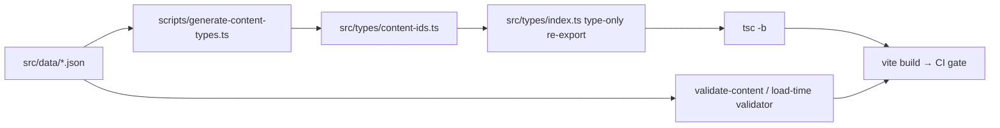

# Specification — v5: Generated Content Ids

> **Parent:** `specs/v4/spec-v4-live-edit.md` §3.1 (supersedes its id-union legs), `spec-v4-data-organization.md` §3, `spec-v4-inline-editing.md` E3.
> **Status:** rev.3 — **approved 2026-10-24.** OQ1 = generated file stays gitignored (D2 stands); OQ2 = dedicated `scripts/smoke-generated-ids.ts`, same shape as `smoke-draft.ts`; OQ3 = out of scope for v5. Implementation follows §10.

---

## Overview

Content ids live in two places today: the record in `src/data/*.json`, and the id type in `src/types/index.ts`. v4 answered that by teaching the editor to patch the TypeScript file. This spec removes the second declaration instead: the id unions are **generated from the JSON at build time**, so a content change is a content change, and every guarantee `tsc` provides today stays in place.

The type contract does not change. Only where the union comes from changes.

---

## 1. Problem — measured

| # | Evidence |
|---|---|
| 1 | A record deleted in edit mode broke `pnpm build`: `TS2741: Property '"logistics-technology"' is missing in type … but required in type 'Record<SkillGroupId, SkillGroupText>'` at `src/i18n/index.ts:69`. The editor had done its own part correctly — `src/data/skills.json` and both text documents no longer carried the id; `src/types/index.ts` still did. |
| 2 | The repair is machinery in the browser save path: `UNION_SPECS`, `readUnionBlock` (line-ending aware, `never`-aware, order-preserving), `renderUnion`, `applyUnionChanges`, `diffIdsWithUnions`, `saveIdUnions` in `src/i18n/draft.ts`, plus `TYPES_FILE` / `fetchTextFile` / `putTextFile`, `typesRef` and the fetch in `EditModeShell.tsx:51,139-144,286-296`, an `EditBar` note (`EditBar.tsx:27,59,251-253`) and two UI strings in `ui/edit.json`. ~150 lines whose only job is keeping a TS file in step with JSON. |
| 3 | That machinery works — commit `1a1fc14 content: update id union members (-facility-management, -local-llm-experiments)` is a real production run — but every content add/delete therefore writes a **code file into the content history**, and the patch has to reason about line endings, member order, `never`, and blob-sha conflicts. |
| 4 | The same coupling is already stale where nothing patches it: `ProjectCategory` (`src/types/index.ts:7-13`) lists six categories; `src/data/projects.json` uses two (`logistics`, `computer-vision`). It is harmless today only because no `Record<ProjectCategory, _>` exists — and `s.projects.categories[project.category]` (`Projects.tsx:66`) is an implicit-`any` lookup, because `tsconfig.app.json` sets no `strict` / `noImplicitAny`. |

**Root cause:** one fact declared twice. Everything in row 2–4 is the cost of keeping the two copies in step.

---

## 2. What the unions guarantee today — and must keep guaranteeing

| Guarantee | Where it comes from | Survives this change? |
|---|---|---|
| Every structure id has Vietnamese text: `ContentVi.skills: Record<SkillGroupId, SkillGroupText>` (`dict-types.ts:121`) — an object literal missing a key is an error **regardless of `strict`** | closed id union | Yes. Same `Record<…>`, union generated instead of hand-written |
| A structure value outside its union is rejected: `projectsJson as ProjectStructure[]` (`src/data/projects.ts:10`) is non-comparable when a `category`/`id` literal is wrong (`TS2352`) | closed id union + `as` assertion | Partly — see D4. The assertion cannot fail any more, because the union is defined by the data. The guard that matters (a category with no label) moves to the validator |
| A malformed document fails the build, CI, and the browser load — never a silent half-render | `tsc` + `src/i18n/validate.ts` at load + `scripts/validate-content.ts` in CI | Yes, unchanged |
| Nothing at runtime | the unions are erased at emit; edit mode casts draft data (`draft.ts:465-472`, `545-553`) | Yes — the generated file is type-only, so no runtime import, no bundle change |

---

## 3. Decisions

### D1 — ids and category values are data, generated from the structure documents

`ProjectId`, `ExperienceId`, `SkillGroupId`, `PhilosophyId`, `ProjectCategory` are derived from `src/data/*.json`.

Rejected:
- **Keep hand-edited unions.** Two sources of truth; the owner must edit code to change content.
- **Keep the v4 browser patch.** It works, but it is permanent machinery in the save path plus a code commit for every content change — the thing this spec exists to remove.
- **Make ids `string`.** Deletes the machinery, and also deletes the exhaustiveness guarantee in row 1 of §2, which is the load-bearing part of §3.1. Enforcement would fall to the validator alone.

### D2 — the generator runs at build/dev time; its output is gitignored

Rejected: committing the generated file (a content edit would still dirty a code file in the working tree and in review — D1's point); generating only inside CI (the IDE and local `tsc` need the file present).

### D3 — renderer kinds stay code-owned

`ProjectSectionStructure.type: 'text' | 'diagram' | 'metrics' | 'code'`, `ExperienceStructure.variant`, `logo`, `PageId`, `ManifestId`, `ContentEntityId`, `Language`, `Palette`, `SocialId` stay hand-written in `src/types/index.ts`. They enumerate **what the code can render**, not what the owner writes — the settings popover's section-type picker offers exactly these values. This is D5 of `spec-v4-live-edit.md` (content editable, design is code), applied to types.

### D4 — `ProjectCategory` is generated, and its guard moves to the validator

New **rule 7** in `src/i18n/validate.ts`: every `category` value used in `projects.json` must have a non-empty label at `ui.<lang>.projects.categories[<value>]` in **both** languages; the issue names the file and the key. Rationale: D1 removes the `as`-assertion typo guard, and the failure that actually matters is not "an unknown category" but "a category that renders an empty badge" (`Projects.tsx:66`). Rule 7 checks exactly that.

### D5 — the type contract itself does not change

`dict-types.ts`, `Record<…>` text coverage, the loaders, the page manifests, validator rules 1–6, the 12-document draft registry, the save pipeline: unchanged.

### D6 — edit mode never writes a TypeScript file again

`saveIdUnions` and everything it needs is deleted, not deprecated. `src/types/index.ts` is not in the writable-document set, and the EditBar loses its union note.

---

## 4. Target architecture



### 4.1 The generated file

`src/types/content-ids.ts` (gitignored):

```ts
// Generated by scripts/generate-content-types.ts — do not edit.
// Sources: src/data/projects.json, src/data/experience.json,
//          src/data/skills.json, src/data/profile.json

export type ProjectId = 'iot-dws-integration' | 'awb-detection';

export type ExperienceId = 'open-to-work' | 'relax-gap' | 'lazada-senior-swe' | 'nexts-founder' | 'sap-senior-swe';

export type SkillGroupId = 'software-engineering' | 'system-architecture' | 'ai-ml' | 'infrastructure' | 'engineering-practices';

export type PhilosophyId = 'build-for-the-real-problem' | 'think-in-systems' | 'measure-impact' | 'keep-learning' | 'business-domain-knowledge-is-a-key-of-success';

export type ProjectCategory = 'logistics' | 'computer-vision';
```

Rules: document order (stable, reviewable output); literals quoted with `JSON.stringify` so any slug is expressible; an empty document emits `never` (`Record<never, T>` accepts `{}`, `X[]` accepts `[]`); LF output; byte-identical output for identical input; if the existing bytes match, the file is not rewritten (no mtime churn for watchers).

### 4.2 `src/types/index.ts` after

Lines 1–5 (`Language`, `Palette`, `SocialId`) and 45–79 (`PageId`, `ManifestId`, `ContentEntityId`, manifest types) stay exactly as they are. Lines 7–13 and 15–43 are replaced by:

```ts
// Content ids and category values are generated from the structure documents
// (spec-v5). Type-only re-export: erased at emit, no runtime import.
export type { ProjectCategory, ExperienceId, PhilosophyId, ProjectId, SkillGroupId } from './content-ids';
```

---

## 5. Implementation Details

### 5.1 New `scripts/generate-content-types.ts`

1. Read the four structure documents with `readFileSync` + `JSON.parse` from paths resolved against `import.meta.url` (the same approach `scripts/smoke-draft.ts` uses for its inputs). **No imports from `src/`** — this script writes the module `src/` depends on.
2. Collect: `projects[].id`, `experience[].id`, `skills[].id`, `profile.philosophy[].id`; and unique `projects[].category` in first-use order.
3. Reject, with the file path in the message and exit 1: a document that is not an array; a missing `philosophy` array; a row without a string `id`; a **duplicate id** in one document (a duplicate would make `Record<…>` narrower than the document, silently).
4. Write `src/types/content-ids.ts` (§4.1). Print a one-line summary in the style of `generate-sitemap.ts`: `content ids generated (2 project, 5 experience, 5 skill group, 5 philosophy, 2 category)`.
5. `scripts/*.ts` are outside both tsconfigs (`tsconfig.node.json` includes only `vite.config.ts`), so the generator is not type-checked by `tsc -b` — it runs through `tsx`, like `validate-content.ts` and `smoke-draft.ts`. Keep it dependency-free. Optional (decide at implementation): add it to `tsconfig.node.json` `include` so its own types are checked.
6. `.oxlintrc.json` sets no `ignorePatterns`, so `pnpm lint` will lint the generated file. It is plain type aliases and should pass; if it does not, add `"ignorePatterns": ["src/types/content-ids.ts"]` rather than changing the generator's output.

### 5.2 Wiring

- `package.json`: `"generate:ids": "pnpm tsx scripts/generate-content-types.ts"`, plus `predev` and `prebuild` hooks, and `"prepare": "pnpm generate:ids"` so a fresh install produces the file before the IDE type-checks. `build` keeps its current body; `validate:content` unchanged. **Hook behaviour verified on pnpm 12.4.1** with a probe package: `pnpm run probe` ran `preprobe` first. CI pins `^12.0.0` (`.gitea/workflows/deploy.yml:27`), same major.
- `.gitea/workflows/deploy.yml` needs no change — verified: the `build` job runs `pnpm tsx scripts/validate-content.ts` (line 28) then `pnpm build` (line 29), so `prebuild` generates the file before `tsc -b`, and validation runs first but reads only JSON, never the generated module. The `generate-resume` job runs `pnpm install` (line 59) — the `prepare` hook generates there too; even without it the resume script is safe, because the re-export in §4.2 is type-only and erased by `tsx`.
- `.gitignore`: `src/types/content-ids.ts`.

### 5.3 Deletions (clean cutover, no shims)

| File | Remove |
|---|---|
| `src/i18n/draft.ts` | `TYPES_FILE` (101), `fetchTextFile` (231-236), `putTextFile` (290-298), the whole id-unions section (`UNION_SPECS`, `UnionBlock`, `MEMBER_LINE`, `CLOSING_LINE`, `nextLine`, `readUnionBlock`, `renderUnion`, `applyUnionChanges`, `diffIdsWithUnions` — 320-427 at writing), `saveIdUnions` (1156-1189), `committedStructures()` (558-566 — **verified single caller**, `diffIdsWithUnions`), and `baseDataOf()` (552-554 — dead code today: a repo-wide search finds no caller). Drop the now-unused `ContentStructures` type import. `fetchDoc` (218-229) **stays** — it is the JSON fetcher for the 12 draft documents and for the read-only UI fetch in §5.4 |
| `src/components/layout/EditModeShell.tsx` | imports `TYPES_FILE` (16), `fetchTextFile` (19), `saveIdUnions` (21); `typesRef` (51); the types-file fetch (139-144); `unionNote` state (63) and its reset (274); the union leg (284-296); the `unionNote` prop (397) |
| `src/components/layout/EditBar.tsx` | `unionNote` in the props type (27) and destructuring (59); the note block (251-253) |
| `src/i18n/locales/{vi,en}/ui/edit.json` | `unionNote`, `unionFailed` (69-70) |
| `scripts/smoke-draft.ts` | checks 9–12 (they test the deleted helpers). Checks 1–8 stay |

`fetchTextFile` / `putTextFile` have no other caller (verified across `src/`): they existed only to read and patch `src/types/index.ts`.

### 5.4 Validator rule 7

In `collectContentIssues` (`src/i18n/validate.ts:69-168`), after rule 6: for each unique category in `structures.projects`, require `ui[lang].projects.categories[value]` to be a non-empty string for `vi` and `en`; issue path `src/i18n/locales/<lang>/ui/projects.json: categories.<value>`.

**Plumbing — corrected by the self-review.** The draft store does **not** hold UI documents: `DRAFT_DOCS` (`draft.ts:48-61`) is exactly the 12 writable content documents, and `DraftStore.validate()` (`draft.ts:585-588`) calls `collectContentIssues` with structures and content texts only. The rule therefore needs a UI source at each call site, and `collectContentIssues` / `validateContent` gain a `ui` argument:

- `src/i18n/index.ts` (load-time): both UI trees are already built there — pass them.
- `scripts/validate-content.ts`: already imports `UI` from `src/i18n` (line 17) — pass it.
- `DraftStore.validate()` (the save gate): `EditModeShell` fetches the two `ui/projects.json` documents read-only at session start with `fetchDoc` and hands them to `store.validate(ui)`. Two extra GETs per edit session; no new transport helper.

Rejected alternative, recorded as the fallback: put the check in the generator (§5.1) instead — no plumbing at all, but a label-less category is then caught at `prebuild`/CI rather than before save, against §5.6 of `spec-v4-live-edit.md` ("an invalid draft never reaches the repository").

Edge case: if the two read-only GETs fail (proxy unreachable — the offline state `EditModeShell` already handles), rule 7 is **skipped with a note in the EditBar**, not treated as a failure: the offline state already disables save, and the CI gate runs the same rule against the committed documents.

### 5.5 Tests

- Remove `smoke-draft.ts` checks 9–12.
- New `scripts/smoke-generated-ids.ts`: build the generator's collector over (a) the real documents — output contains exactly the ids the documents carry and nothing else; (b) a synthetic document with an empty array — `never` emitted; (c) a duplicate id — error naming the file; (d) idempotence — running twice yields identical bytes. Open question OQ2 asks whether this file or a case inside `validate-content.ts` is the right home.

### 5.6 Docs

- `spec-v4-live-edit.md` §3.1: add a "Superseded 2026-10-24 by `spec-v5-generated-content-ids.md`" note in the style already used for §5.4, keeping the text as the implementation record; add §12 row 23.
- `AGENTS.md`: Data Layer — ids and category values are generated, `src/types/index.ts` holds code-owned unions only; Live Edit — edit mode writes JSON only; Scripts — `generate:ids` and the `predev`/`prebuild`/`prepare` hooks; Commands table updated.
- `README.md` if it documents `pnpm dev` steps (check during implementation).

---

## 6. Affected Files

| File | Action |
|---|---|
| `scripts/generate-content-types.ts` | **new** — generator |
| `src/types/content-ids.ts` | **new, generated, gitignored** |
| `src/types/index.ts` | edit 7-13 + 15-43 → type-only re-export |
| `src/i18n/draft.ts` | delete 101, 231-247, 290-298, 320-414, 545-553, ≈1148-1189 |
| `src/components/layout/EditModeShell.tsx` | delete 16, 19, 21, 51, 63, 139-144, 274, 284-296, 397 |
| `src/components/layout/EditBar.tsx` | delete 27, 59, 251-253 |
| `src/i18n/locales/vi/ui/edit.json`, `src/i18n/locales/en/ui/edit.json` | delete 69-70 |
| `src/i18n/validate.ts` | new rule 7 in `collectContentIssues` (69-168) + signature growth; `validateContent` (170-180) |
| `src/i18n/index.ts` | pass the UI dictionaries to the load-time validation |
| `src/i18n/draft.ts` `DraftStore.validate()` | pass UI documents (572-575) |
| `scripts/validate-content.ts` | pass UI documents |
| `scripts/smoke-draft.ts` | delete checks 9–12 |
| `scripts/smoke-generated-ids.ts` | **new** — generator regression smoke (OQ2) |
| `package.json` | `generate:ids`, `predev`, `prebuild`, `prepare` |
| `.gitignore` | `src/types/content-ids.ts` |
| `docs/design/specs/v4/spec-v4-live-edit.md` | §3.1 superseded note, §12 row 23 |
| `AGENTS.md` | Data Layer / Live Edit / Scripts / Commands |

Unchanged on purpose: `src/i18n/dict-types.ts`, `src/data/*.ts` loaders, `src/data/pages/*.json`, `nginx.conf`, `compose.yaml`, `.gitea/workflows/*` (verified in §5.2), `scripts/generate-resume.ts`, `scripts/generate-sitemap.ts`.

---

## 7. Acceptance Criteria

- [x] On a fresh clone, `pnpm install` or `pnpm dev` produces `src/types/content-ids.ts` and `pnpm build` passes. — `pre<script>` hook execution verified on pnpm 12.4.1 (§9), and every `pnpm build` / `pnpm tsx` run in this session regenerated the file through those hooks or through `generate:ids`. ⬜ Not verified: an actual fresh-clone checkout.
- [x] A content add or delete touches JSON only: `git status` after such an edit shows no `src/types/*` entry. — `git status --porcelain --ignored src/types/` lists the generated file as `!! src/types/content-ids.ts` (ignored, never a status entry), and after the add/delete experiments below, `git status --porcelain src/data src/i18n/locales` carried no `src/types` path.
- [x] Deleting a record while its text is still present is an error the build catches; a *stale union* can no longer cause it. Verified with a throwaway skill group, both directions:
  - structure record without text (`tmp-ghost-group` added to `src/data/skills.json` only) → `src/i18n/index.ts(69,3): error TS2741: Property '"tmp-ghost-group"' is missing in type … but required in type 'Record<SkillGroupId, SkillGroupText>'` — the same class of failure the owner reported, now produced by the regenerated union rather than a hand-maintained one;
  - text without a record (`tmp-ghost-text` added to `locales/vi/content/skills.json` only) → `pnpm validate:content`: `src/i18n/locales/vi/content/skills.json: tmp-ghost-text: orphan text key — no such skill group in structure`. `tsc` alone does **not** catch this direction — extra keys in an imported JSON are assignable to `Record<Id, …>` — so the validator is the gate here, exactly as before the change.
  - Staleness is impossible by construction: after the structure document was restored and regenerated, `grep -c "tmp-ghost" src/types/content-ids.ts` → `0`.
- [x] A category used in `projects.json` without a label in both `ui/projects.json` files fails `pnpm validate:content` with the exact file and key. Verified: `projects[0].category = "tmp-ghost-cat"` produced `src/i18n/locales/vi/ui/projects.json: categories.tmp-ghost-cat: category used by a project has no label in this language` and the same line for `en`; with the union regenerated, `tsc` also reported `TS7053` at `src/components/sections/Projects.tsx:66`, `src/pages/ProjectDetailPage.tsx:73`, `src/pages/ProjectsListPage.tsx:55` — the label-indexing sites §4.3 names.
- [x] Edit-mode save writes only the 12 JSON documents; no `content: update id union members` commit can ever appear. `grep -rn "saveIdUnions|diffIdsWithUnions|applyUnionChanges|UnionLogEntry|onUnionsSaved|unionNote|unionError" src scripts` → no match; neither `ui/edit.json` carries a `union*` key.
- [x] `pnpm build`, `pnpm lint` (no new warnings — the four warnings it prints are the pre-existing `useTheme.tsx`, `provider.tsx`, `Footer.tsx`, `Typewriter.tsx` ones), `pnpm validate:content`, `pnpm tsx scripts/smoke-draft.ts` (11/11), `pnpm tsx scripts/smoke-generated-ids.ts` (7/7) all pass.
- [x] Resume output unchanged. `pnpm build:resume-all` renders both PDFs in both states, and the HTML handed to Playwright is byte-identical with identical content documents: sha256 `f4abe88c29f8fbe4…` (en) and `2a3ed5e23c8f8e1a…` (vi) from a run with the refactor stashed and from a run with it applied (a temporary `RESUME_DUMP_DIR` write in `generate-resume.ts`, removed after the check). `pdftotext` is not installed on this machine, so the comparison is on the rendered HTML — the input to the PDF; PDF bytes legitimately differ by Playwright metadata.
- [x] Bundle shape unchanged: 10 chunks with names identical to a build of the same documents before the refactor, and no runtime reference to the generated module (`grep -rl "content-ids" dist/` → nothing; the re-export is type-only and erased).

---

## 8. Open questions — decided 2026-10-24

- **OQ1 — generated file: gitignored (owner's call).** `src/types/content-ids.ts` is generated output, not authored code: no content commit ever carries a code file, and no content review shows a `src/types/*` diff. The id list is still reviewable — it is the id array in the structure documents, which is where it was always written.
- **OQ2 — generator regression test: dedicated `scripts/smoke-generated-ids.ts`.** Same shape as the existing `scripts/smoke-draft.ts`; `validate-content.ts` stays a validator, not a test harness.
- **OQ3 — `noImplicitAny`: out of scope for v5.** `tsconfig.app.json` sets no `strict`, so `s.projects.categories[category]` is implicit `any` today and rule 7 is the guard. Enabling it is its own task with unmeasured fallout.

---

## 9. Risks & Mitigations

| Risk | Mitigation |
|---|---|
| Fresh clone / IDE errors before the first generation | `prepare` on install + `predev`; the generator names the file and the reason in its error |
| `pre<script>` hooks not running | verified on pnpm 12.4.1 (a probe script ran `preprobe` before `probe`); CI pins `^12.0.0`. Note the CI `build` job never runs `pnpm install`, so `prebuild` — not `prepare` — is what guarantees generation there |
| Losing the `as`-assertion typo guard for `category` | validator rule 7 checks the real failure (no label); the category list is reviewed as a JSON diff in Gitea |
| Generated file committed by accident | `.gitignore` entry + an acceptance check that a content edit dirties JSON only |
| Draft data in the browser is not type-checked | unchanged from v4 — edit mode casts draft data; the CI build is the gate, as in D4 of `spec-v4-live-edit.md` |
| A deleted project id that is already a published URL | unchanged behaviour from v4; `pnpm build` regenerates `sitemap.xml` |
| Removing the EditBar union note leaves an orphan UI string | both keys deleted with the feature; `edit` group keeps every other key |

---

## 10. Progress Tracking

| # | Task | Status |
|---|------|--------|
| 1 | This spec (rev.1) reviewed & approved by owner — OQ1–OQ3 decided | ✅ Decided 2026-10-24 — OQ1 gitignored, OQ2 dedicated generator smoke, OQ3 out of scope (§8) |
| 2 | `scripts/generate-content-types.ts` + generated file + `package.json` hooks + `.gitignore` (`deploy.yml` confirmed unchanged) | ✅ Done 2026-10-24 — generator writes the 777-byte module (2 project, 5 experience, 5 skill group, 5 philosophy, 2 category ids) and is byte-stable on a second run; `generate:ids` + `predev` / `prebuild` / `prepare` in `package.json`; `.gitignore` carries `src/types/content-ids.ts`; `.gitea/workflows/deploy.yml` untouched |
| 3 | `src/types/index.ts` re-export; delete the v4 union machinery in `draft.ts`, `EditModeShell.tsx`, `EditBar.tsx`, `ui/edit.json` | ✅ Done 2026-10-24 — `index.ts` re-exports the generated unions type-only and keeps `Language`, `Palette`, `SocialId`, `PageId`, `PageManifestClaim`, `PageManifest`, `Theme`; `saveIdUnions` / `diffIdsWithUnions` / `applyUnionChanges` / `readUnionBlock` / `unionNote` / `unionError` / `UnionLogEntry` / `onUnionsSaved` / the EditBar union card / `edit.union.*` deleted — `grep` over `src` + `scripts` finds no match |
| 4 | Validator rule 7 + `ui` argument at all three call sites (`index.ts`, `validate-content.ts`, `store.validate(ui)` fed by a read-only `fetchDoc` pair in `EditModeShell`) | ✅ Done 2026-10-24 — verified end-to-end: a project with `category: "tmp-ghost-cat"` fails `pnpm validate:content` naming both `ui/projects.json` files and `categories.tmp-ghost-cat`; the draft store skips the rule when the labels cannot be read and the EditBar says so |
| 5 | Tests: remove `smoke-draft.ts` 9–12; add the generator smoke (OQ2) | ✅ Done 2026-10-24 — `smoke-draft.ts` 11/11 (checks 9–12 replaced by the rename re-sluging check and the category-label rule check); `scripts/smoke-generated-ids.ts` 7/7: the unions equal the documents, the file on disk equals what these documents generate now, output byte-stable, `never` for an emptied document, a duplicate id refused naming the file, a record with no usable id or category refused naming the file, every slug quoted so it round-trips in document order |
| 6 | Verification run: `pnpm build`, `pnpm lint`, `pnpm validate:content`, both smokes, resume PDF text diff, `dist/` chunk list comparison against a build of the same documents | ✅ Done 2026-10-24 — all commands pass; resume HTML byte-identical before/after with identical documents (sha256 in §7); `dist/` chunk names identical, 10 chunks, no runtime reference to the generated module; `pnpm build:resume-all` produces both PDFs in both states. ⬜ Not run: a fresh-clone checkout |
| 7 | Docs: `spec-v4-live-edit.md` §3.1 superseded note + §12 row 23, `AGENTS.md`, `README.md` if needed | ✅ Done 2026-10-24 — §3.1 banner, §12 row 22 marked superseded + row 23 added here; `AGENTS.md` Commands row, Data Layer bullet, Live Edit bullet rewritten, component tree, Scripts list, Gotcha 8, Design Specs v5 row; `README.md` `generate:ids` row + the generated-ids note |
